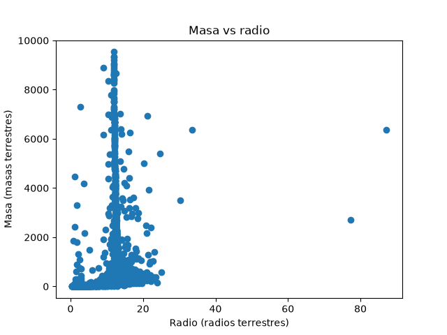
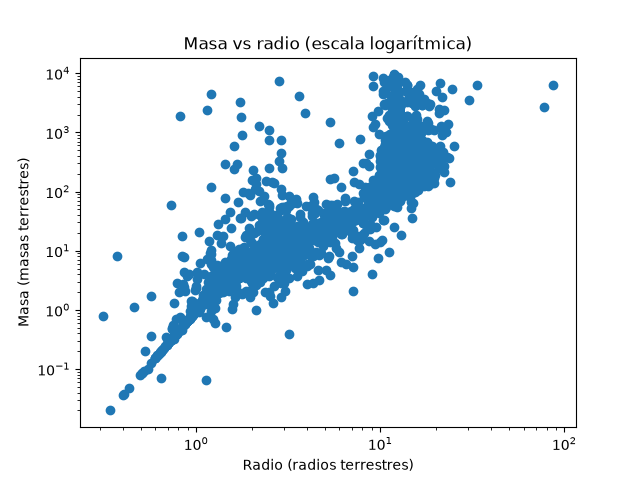
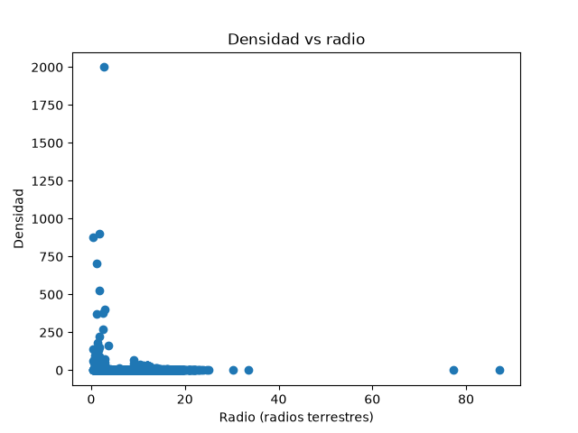
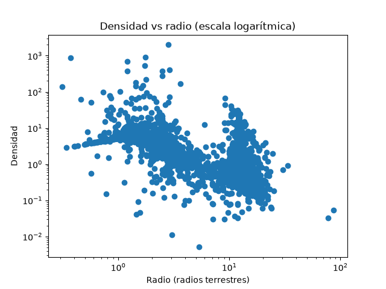
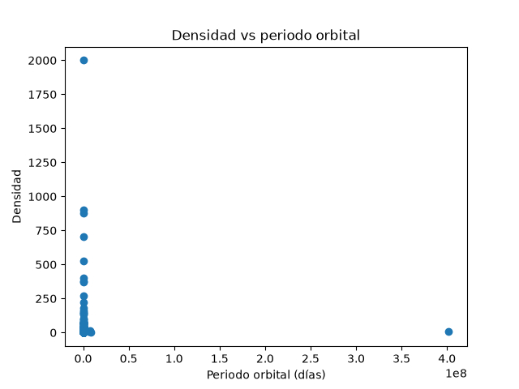
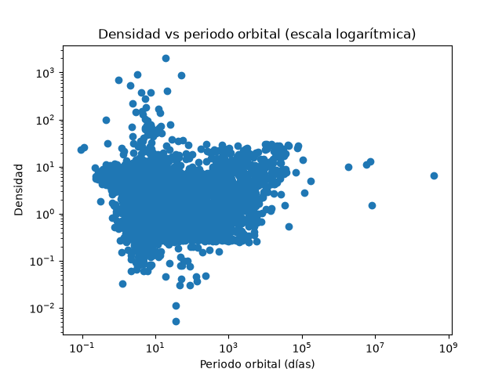
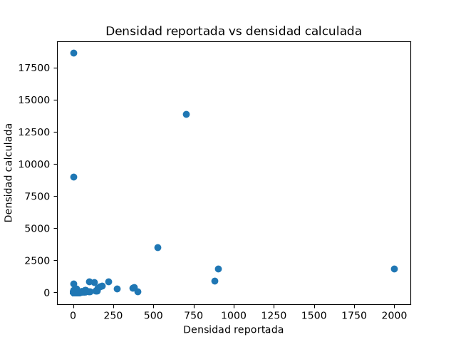
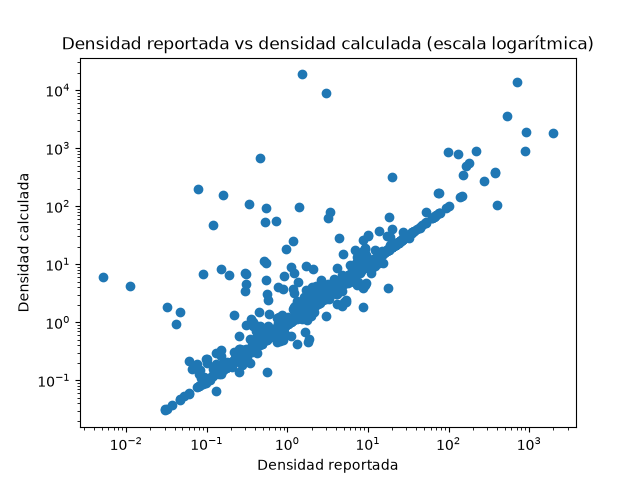

# 🪐 Exoplanet Explorer


Sistema de análisis exploratorio y estadístico en Python que consulta datos reales de exoplanetas confirmados directamente desde el **NASA Exoplanet Archive (TAP API)** para estudiar sus relaciones físicas fundamentales y detectar anomalías estadísticas y astrofísicas.

---

## 🎯 Objetivo e Hipótesis de Trabajo

El propósito del proyecto es construir una base analítica capaz de identificar exoplanetas estadísticamente inusuales dentro de la población conocida, sirviendo como cimiento para futuros modelos de análisis de datos e inteligencia artificial aplicados a la astronomía.

* **Hipótesis inicial:** Algunos exoplanetas presentan propiedades individuales extremas que se alejan significativamente de la población conocida.
* **Evolución de la hipótesis:** Tras observar la alta sensibilidad a valores extremos y posibles artefactos de medición en el catálogo, el enfoque evolucionó hacia la detección de **anomalías multivariadas y de consistencia física**: identificar planetas cuyas combinaciones de masa, radio y densidad se desvían del comportamiento esperado para cuerpos de tamaño similar, o cuya densidad reportada diverge de la densidad teórica esférica.

---

## 📊 Fuente de Datos y Variables

Los datos se extraen en tiempo real mediante una consulta TAP sobre la tabla `pscomppars` (*Planetary Systems Composite Parameters*) del **NASA Exoplanet Archive**:

| Variable | Descripción | Unidad | Datos faltantes (Dataset inicial) |
| :--- | :--- | :--- | :--- |
| `pl_name` | Nombre del exoplaneta | Texto | 0 |
| `pl_rade` | Radio planetario | Radios terrestres ($R_\oplus$) | 50 |
| `pl_bmasse` | Mejor estimación de masa planetaria (Masa o $M \cdot \sin(i)$) | Masas terrestres ($M_\oplus$) | 31 |
| `pl_dens` | Densidad planetaria reportada | $\text{g/cm}^3$ | 145 |
| `pl_orbper` | Periodo orbital | Días | 353 |

* **Tamaño del dataset original:** 6,375 exoplanetas.
* **Tamaño post-limpieza (`df_complete`):** 6,229 exoplanetas con registros completos de masa, radio y densidad (146 registros incompletos descartados).

---

## 📈 Principales Hallazgos Estadísticos

### 1. Estadísticas Descriptivas (`n = 6,229`)

Las variables físicas abarcan varios órdenes de magnitud y presentan distribuciones fuertemente asimétricas con presencia de valores extremos:

| Variable | Media | Desviación Estándar | Mínimo | Máximo |
| :--- | :--- | :--- | :--- | :--- |
| **Radio (`pl_rade`)** | $5.86\ R_\oplus$ | $5.41\ R_\oplus$ | $0.31\ R_\oplus$ | $87.21\ R_\oplus$ |
| **Masa (`pl_bmasse`)** | $391\ M_\oplus$ | $1,123\ M_\oplus$ | $0.02\ M_\oplus$ | $9,535\ M_\oplus$ |
| **Densidad (`pl_dens`)** | $4.83\ \text{g/cm}^3$ | $33.96\ \text{g/cm}^3$ | $0.0051\ \text{g/cm}^3$ | $2,000\ \text{g/cm}^3$ |

### 2. Análisis de Correlaciones (Lineal vs. Monotónica)

Debido a la naturaleza no lineal de las leyes de escala planetaria y la influencia de valores extremos, se compararon tres coeficientes de correlación:

| Relación Analizada | Pearson (Lineal) | Spearman (Monotónica) | Kendall (Orden) | Interpretación Astrofísica |
| :--- | :---: | :---: | :---: | :--- |
| **Masa vs. Radio** | `0.452` | **`0.935`** | `0.817` | Relación positiva muy fuerte pero no lineal; existen distintas poblaciones planetarias (rocosos, sub-Neptunos, gigantes gaseosos). |
| **Densidad vs. Radio** | `-0.044` | **`-0.642`** | `-0.578` | Tendencia inversa clara ($\rho \propto R^{-3}$): al aumentar el radio hacia gigantes gaseosos, la densidad media disminuye. |
| **Masa vs. Densidad** | — | **`-0.419`** | `-0.404` | Relación negativa moderada: planetas muy masivos suelen tener volúmenes enormes que reducen su densidad global. |
| **Densidad vs. Periodo Orbital** | `0.001` | `-0.084` | `-0.069` | Sin correlación monotónica directa observable a nivel poblacional general. |

> **Conclusión metodológica:** El coeficiente de **Pearson** pierde gran parte de la estructura real de los datos debido a la no-linealidad y los valores extremos (ej. reporta `-0.044` en Densidad vs. Radio), mientras que **Spearman** (`-0.642`) y las transformaciones logarítmicas capturan fielmente el comportamiento físico.

---

## 🖼️ Visualizaciones Generadas

El script `main.py` genera comparativas en escala lineal y logarítmica dentro del directorio `figures/`:

### Masa vs. Radio
En escala logarítmica emerge la estructura real de las poblaciones planetarias y se observa una alta dispersión de masa para radios entre $10$ y $20\ R_\oplus$.

| Escala Lineal | Escala Logarítmica |
| :---: | :---: |
|  |  |

### Densidad vs. Radio
Muestra cómo los planetas pequeños tienden a concentrarse en regímenes de mayor densidad (rocosos), decreciendo a medida que aumenta el radio, junto con puntos que escapan de la tendencia general.

| Escala Lineal | Escala Logarítmica |
| :---: | :---: |
|  |  |

### Densidad vs. Periodo Orbital
La escala logarítmica permite descomprimir la población cercana a la estrella anfitriona, confirmando la alta dispersión de densidades para un mismo periodo orbital.

| Escala Lineal | Escala Logarítmica |
| :---: | :---: |
|  |  |

---

## 🔍 Detección de Outliers y Verificación Física

### 1. Detección mediante Rango Intercuartil (IQR)
Se identificaron **319 posibles outliers de densidad**, incluyendo registros extremos en el catálogo como `KOI-2513.01` ($2,000\ \text{g/cm}^3$), `Kepler-245 e` ($902\ \text{g/cm}^3$) y `Kepler-37 e` ($879\ \text{g/cm}^3$).

### 2. Contraste entre Densidad Reportada y Densidad Calculada
Un outlier estadístico no implica necesariamente un planeta físicamente extraordinario; puede originarse por alta incertidumbre observacional, estimaciones de masa mínima ($M \cdot \sin(i)$) o discrepancias al combinar parámetros de distintas publicaciones. Para auditar los datos, se contrasta la densidad reportada (`pl_dens`) contra la densidad teórica de una esfera a partir de la densidad media terrestre ($5.514\ \text{g/cm}^3$):

$$\rho_{\text{calculada}} = 5.514 \times \frac{\text{pl\_bmasse}}{\text{pl\_rade}^3}$$

| Escala Lineal | Escala Logarítmica |
| :---: | :---: |
|  |  |

### 3. Filtro Multivariado y Verificación de Dominio (Domain Knowledge)
Al aplicar filtros extremos sobre la proporción de discrepancia (Densidad Reportada > 10x o < 0.1x respecto a la calculada), se aislaron casos físicamente imposibles como **Kepler-80 f** y **Kepler-49 d**. 

La revisión en la literatura astrofísica confirmó que estos valores extremos no representan anomalías físicas reales, sino **errores de medición arrastrados en el catálogo** (por ejemplo, planetas desacoplados de cadenas resonantes donde la estimación de masa por TTV no es fiable, según MacDonald et al., 2016).

**Entregable final:** 
Los outliers descartados por inconsistencia multivariada fueron exportados al archivo `planetas_anomalos.csv` para limpiar la base de datos poblacional de cara al entrenamiento de futuros modelos de Inteligencia Artificial.

---

## ⚙️ Instalación y Ejecución

1. **Clonar el repositorio:**
   ```bash
   git clone [https://github.com/TU_USUARIO/exoplanet-explorer.git](https://github.com/TU_USUARIO/exoplanet-explorer.git)
   cd exoplanet-explorer